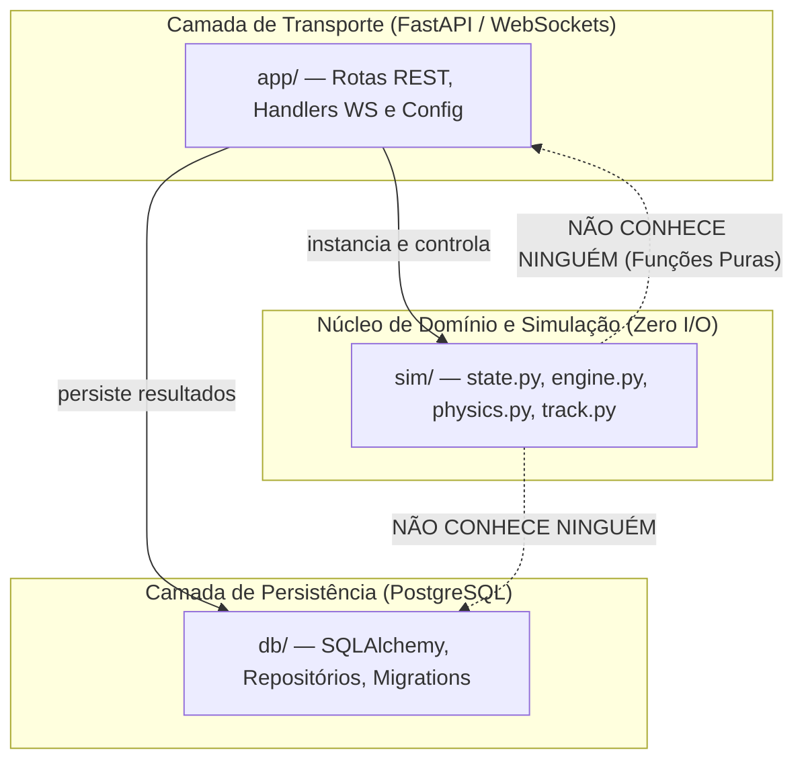
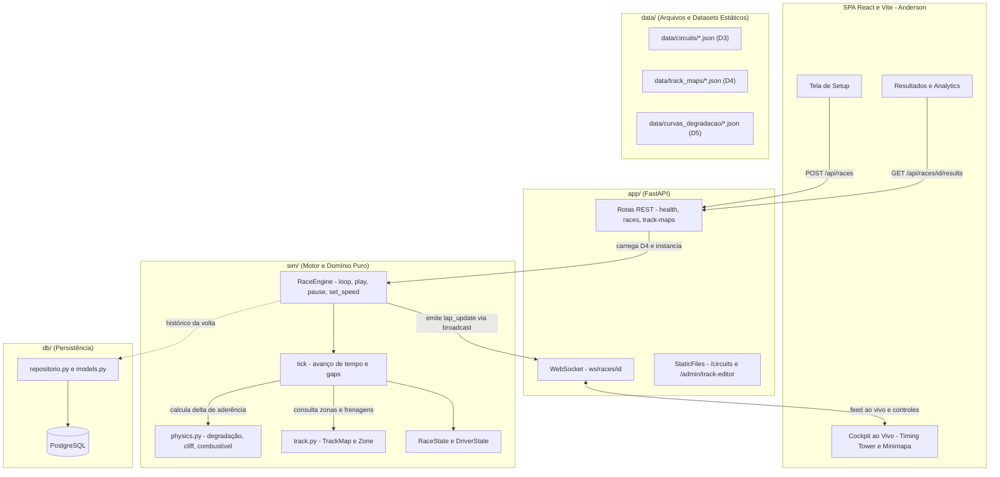
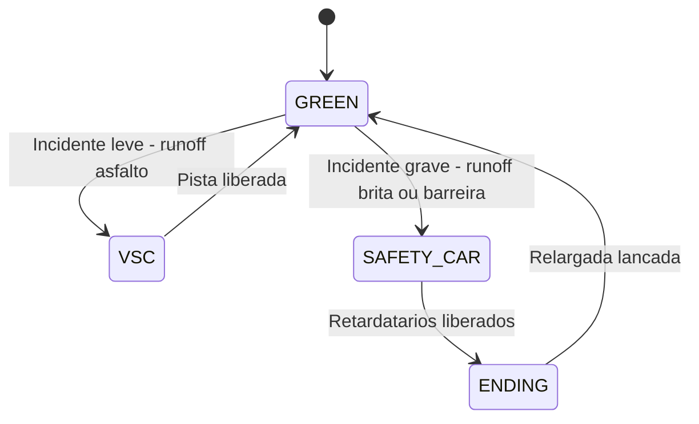

# ApexSim — Arquitetura de Software

> **Status:** Especificação técnica consolidada — Marco M1 concluído (Track Editor, anotações semânticas D4, calibração de física e scaffold Frontend incorporados)
> **Disciplina:** MC857 · Turma A · 2º Semestre 2026
> **Documentos relacionados:** [frontend-ux.md](frontend-ux.md) · [integracao-m2.md](integracao-m2.md) · [fisica.md](fisica.md) · [banco-de-dados.md](banco-de-dados.md) · [track-map-schema.md](track-map-schema.md)

---

## 1. Visão Geral e Decisões de Projeto

O **ApexSim** é um simulador estocástico e determinístico de Fórmula 1 com modelos matemáticos de ritmo, degradação física, eventos de pista e estratégia de pit stop.

### 1.1 Princípios

1. **Separação rígida entre Domínio, Motor e Transporte:**
   - **Domínio (Física, Pistas, Estratégia):** Funções puras, sem efeitos colaterais, sem dependência de FastAPI ou WebSockets.
   - **Motor:** Orquestrador em memória — relógio, avanço de voltas, seed determinística.
   - **Transporte (FastAPI & WebSockets):** Única camada que faz I/O com o frontend.
2. **Determinismo:** `RaceEngine(seed=X)` gera exatamente a mesma sequência de eventos e tempos de volta em qualquer execução. O `random.Random` deve ser injetado no `RaceState` — nunca usar o módulo `random` global.
3. **Persistência em Lote:** Estado vivo em memória durante a corrida. O banco recebe histórico uma vez por volta, nunca a cada tick.

### 1.2 Padrão Arquitetural: Monólito Modular

O backend do ApexSim é projetado como um **Monólito Modular**. Em vez de microsserviços distribuídos (que adicionariam latência de rede crítica para um loop de simulação de alta frequência) ou um monolito desestruturado, o código é particionado em **três módulos principais com fronteiras rígidas (Bounded Contexts)**:

1. **`sim` — Domínio e Motor de Simulação (Core)**:
   - **Regra de ouro:** Código puramente matemático e determinístico em memória.
   - **Zero dependências externas:** Não importa FastAPI, Uvicorn, SQLAlchemy ou WebSockets.
   - **Componentes:**
     - `physics.py`: Equações de degradação física de pneus (quadrática + linear + cliff logístico), consumo de combustível e temperatura.
     - `track.py`: Modelo semântico `TrackMap` e `Zone` (Contrato D4).
     - `state.py`: Máquina de estado da corrida (`RaceState`, `DriverState`, `tick()`).
     - `engine.py`: Orquestrador assíncrono do loop de simulação, controle de relógio (`play`, `pause`, `set_speed`) e semente determinística (`Random(seed)`).
2. **`db` — Persistência Relacional**:
   - Camada de acesso ao banco PostgreSQL via SQLAlchemy.
   - Responsável por armazenar pilotos, equipes, circuitos e persistir resultados históricos em lote (fim da volta e pós-corrida).
   - Não conhece regras de transporte web (`app`) nem regras de física do carro (`sim`).
3. **`app` — Transporte e Orquestração (Web Layer)**:
   - API FastAPI: endpoints REST (`/health`, `/api/races`, `/api/track-maps`) e WebSocket (`/ws/races/{id}`).
   - Orquestra os módulos: recebe o comando do usuário, instancia o `RaceEngine` em memória e despacha snapshots de estado (`lap_update`) para o frontend.
4. **`pipeline` — ETL Offline e Validação**:
   - Scripts executados via linha de comando (`make dados`, `make circuitos`, `make validate-tracks`).
   - Processamento de dados brutos do Kaggle e telemetria do FastF1.



---

## 2. Componentes e Fluxo de Dados



---

## 3. Organização do Repositório (Alvo Consolidado M2)

A raiz do projeto é enxuta, dividida em **5 diretórios com propósitos distintos**:

```
ApexSim/
├── backend/                     # ⚙️ Módulos do Backend (Monólito Modular)
│   ├── app/                     # Camada Web: FastAPI, REST e WebSockets
│   │   ├── main.py
│   │   ├── config.py
│   │   ├── api/                 # Endpoints REST (/health, /api/races, /api/track-maps)
│   │   └── websocket/           # Handler nativo em Python (/ws/races/{id})
│   ├── sim/                     # Módulo Core: Motor e Domínio Puro (Zero I/O)
│   │   ├── engine.py            # RaceEngine (loop, play/pause, seed)
│   │   ├── state.py             # RaceState, DriverState, tick()
│   │   ├── physics.py           # Física de pneus, combustível e temperatura
│   │   └── track.py             # TrackMap e Zone (consultas espaciais 1D)
│   ├── db/                      # Camada de Persistência Relacional
│   │   ├── base.py
│   │   ├── models.py            # Modelos SQLAlchemy (PostgreSQL)
│   │   ├── repositorio.py
│   │   └── seed.py
│   ├── pipeline/                # Scripts ETL e validação offline
│   │   ├── circuits.py
│   │   ├── kaggle_download.py
│   │   ├── degradacao.py
│   │   └── validate_track_map.py
│   ├── migrations/              # Alembic
│   └── tests/                   # 🧪 Suíte de testes centralizada
│       ├── sim/                 # Testes do motor e física (test_state, test_physics, test_track)
│       ├── db/                  # Testes de modelos e migrações
│       └── app/                 # Testes das rotas HTTP e WebSockets
├── frontend/                    # 🖥️ Aplicação do Usuário (SPA React + Vite)
├── data/                        # 📦 Single Source of Truth para Dados e Artefatos Estáticos
│   ├── circuits/                # Geometria 2D dos circuitos (D3)
│   ├── track_maps/              # Mapas semânticos oficiais 1D (D4)
│   ├── curvas_degradacao/       # Curvas de degradação geradas pelo Kaggle (D5)
│   ├── mapeamentos/             # Mapeamentos de pilotos e equipes
│   └── raw/                     # Datasets brutos (gitignored)
├── tools/                       # 🛠️ Ferramentas de Engenharia e P&D (Offline)
│   ├── track_editor/            # Ferramenta web standalone de anotação de pistas
│   └── notebooks/               # Jupyter Notebooks de prototipação e análise
├── docs/                        # 📚 Especificação Técnica e Guias
├── docker-compose.yml
└── Makefile
```

---

## 4. Contratos de Dados

### 4.1 Contrato D3: Geometria do Circuito (Octávio → Daniel & Anderson)

Gerado por `make seed` (FastF1 + Ramer-Douglas-Peucker). Servido via `StaticFiles` em `/circuits/{id}.json`.

```json
{
  "circuit_id": "interlagos",
  "length_m": 4309,
  "points": [
    { "x": 0.0, "y": 0.0, "distance_m": 0.0 },
    { "x": 12.4, "y": 3.1, "distance_m": 12.8 }
  ],
  "meta": {
    "fonte": "FastF1", "ano": 2024, "sessao": "R",
    "piloto": "VER", "epsilon_m": 1.23, "fator_escala": 1.0041
  }
}
```

### 4.2 Contrato D4: Mapa de Zonas Semânticas (Daniel → Isaac & Gabriel)

Persistido via `POST /api/track-maps/{circuit_id}` e lido em runtime via `TrackMap.load(circuit_id)` (implementado em `backend/app/models/track.py`).

```json
{
  "circuit_id": "interlagos",
  "length_m": 4309,
  "points": [
    { "x": -374.11, "y": -537.05, "distance_m": 0.0 }
  ],
  "zones": [
    {
      "type": "sector",
      "start_m": 0, "end_m": 1200,
      "props": { "number": 1 }
    },
    {
      "type": "braking_zone",
      "start_m": 240, "end_m": 370,
      "props": { "severity": "alta", "runoff": "asfalto" }
    },
    {
      "type": "drs_detection",
      "start_m": 3850, "end_m": 3850,
      "props": {}
    },
    {
      "type": "pit_lane",
      "start_m": 4120, "end_m": 4309,
      "props": { "speed_limit_kmh": 80, "time_loss_s": 18.5 }
    }
  ]
}
```

#### Tipos de zona homologados:
`sector`, `corner`, `braking_zone`, `straight`, `drs_detection`, `drs_activation`, `pit_entry`, `pit_exit`, `pit_lane`, `overtaking_spot`.

#### Métodos de consulta da classe `TrackMap`:
- `TrackMap.load(circuit_id: str)`: Carrega e instancia o mapa semântico a partir de `track_maps/{circuit_id}.json`.
- `track.get_zones_at(distance_m: float) -> list[Zone]`: Retorna todas as zonas ativas naquela coordenada linear.
- `track.get_active_sector(distance_m: float) -> int`: Retorna o número do setor atual (`1`, `2` ou `3`).
- `track.get_braking_zone_at(distance_m: float) -> Zone | None`: Retorna a zona de frenagem ativa com suas propriedades de severidade e área de escape (`runoff`).
- `track.is_drs_active(distance_m: float) -> bool`: Consulta se o carro está em zona de ativação de DRS.
- `track.is_in_pit_lane(distance_m: float) -> bool`: Consulta se o carro está dentro do corredor dos boxes.

#### Rotas e Validação:
- `GET /admin/track-editor/`: Aplicação web standalone para visualização e anotação contínua (Canvas 2D + Régua 1D).
- `GET /api/track-maps/{circuit_id}`: Recupera o JSON homologado.
- `POST /api/track-maps/{circuit_id}`: Salva modificações diretamente no diretório do projeto.
- `make validate-tracks`: Executa validação de integridade estrutural, continuidade de setores e limites espaciais (`backend/app/pipeline/validate_track_map.py`).

### 4.3 Contrato D2: Envelope WebSocket (Motor → Frontend)

#### `lap_update` — Servidor → Cliente
```json
{
  "type": "lap_update",
  "race_id": "uuid",
  "current_lap": 18, "total_laps": 53,
  "track_status": "GREEN", "weather": "DRY",
  "drivers": [{
    "driver_id": "VER", "position": 1,
    "gap_to_leader": 0.0, "gap_to_ahead": null,
    "last_lap_time": 82.415,
    "tyre_compound": "MEDIUM", "tyre_age": 18,
    "fuel_load_kg": 72.1, "pit_status": "NONE",
    "pit_stops_made": 0, "is_retired": false,
    "drs_active": false,
    "distance_m": 1240.5
  }]
}
```

> `distance_m` é necessário para o Minimapa interpolar a posição no SVG.

#### `event_update` — Servidor → Cliente
```json
{
  "type": "event_update", "race_id": "uuid", "lap": 18,
  "event_type": "SAFETY_CAR_DEPLOYED",
  "involved_drivers": ["SAR"], "zone_id": "s_do_senna_brake",
  "description": "Acidente na S do Senna. Escapatória de brita. Safety Car acionado."
}
```

#### Comandos — Cliente → Servidor
```json
{ "action": "pause" }
{ "action": "resume" }
{ "action": "set_speed", "speed_multiplier": 5 }
```

### 4.4 Contrato Interno: Motor ↔ Física (Gabriel ↔ Isaac)

Funções puras chamadas dentro do `tick()`. Sem dependência de FastAPI ou I/O.

```python
def tyre_time_loss(compound: str, age_laps: int, track_temp: float = 35.0) -> float: ...
def fuel_time_delta(fuel_kg: float) -> float: ...
def dirty_air_penalty(gap_ahead_s: float) -> float: ...
def drs_gain(is_in_activation_zone: bool, gap_at_detection: float) -> float: ...
def sample_lap_events(
    drivers: list[DriverState],
    track_zones: list[Zone],
    weather: str,
    rng: random.Random,  # injetado, nunca global
) -> list[RaceEvent]: ...
```

#### Máquina de estados do Safety Car



---

## 5. Marcos e Critérios de Aceite

| Marco | Prazo | Critério | Status |
|---|---|---|---|
| **M1** | Sem. 3–5 | Cada trilha tem testes unitários passando isoladamente (Física, Banco, Geometria D3, Pistas D4 e Frontend). | **Concluído (100%)** |
| **M2** | Sem. 6 | FastAPI instancia `RaceEngine`, emite `lap_update` e a Timing Tower renderiza ao vivo. Ver [integracao-m2.md](integracao-m2.md). | Em andamento |
| **M3** | Sem. 7–10 | `tick()` chama física do Isaac. Eventos usam `TrackMap` do Daniel. | Planejado |
| **M4** | Sem. 11–13 | Minimapa com `distance_m`. Stint Chart e Lap Chart do banco. Monte Carlo ativo. | Planejado |
| **M5** | Sem. 14–15 | Demo com seed fixa. Relatório consolidado. | Planejado |
