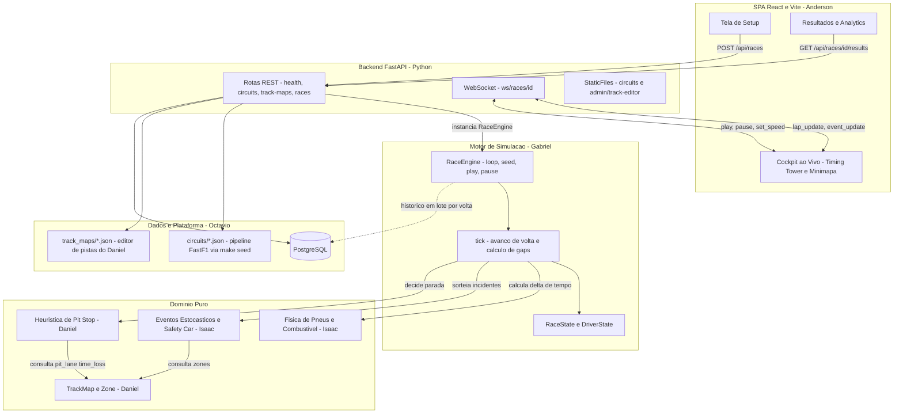
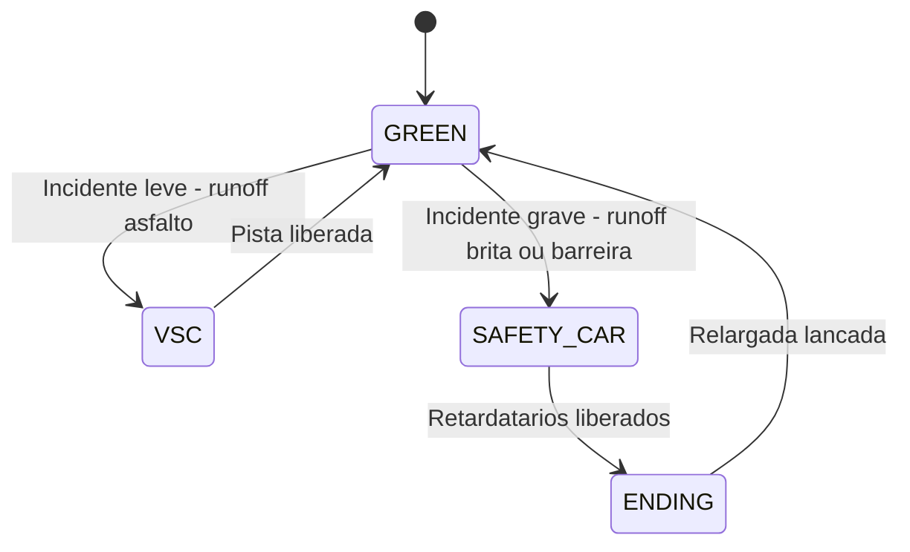

# ApexSim — Arquitetura de Software

> **Status:** Especificação técnica — aguardando PRs do Daniel e do Anderson para incorporar estado final do M1
> **Disciplina:** MC857 · Turma A · 2º Semestre 2026
> **Documentos relacionados:** [frontend-ux.md](frontend-ux.md) · [integracao-m2.md](integracao-m2.md) · [fisica.md](fisica.md) · [banco-de-dados.md](banco-de-dados.md)

---

## 1. Visão Geral e Decisões de Projeto

O **ApexSim** é um simulador estocástico e determinístico de Fórmula 1 com modelos matemáticos de ritmo, degradação física, eventos de pista e estratégia de pit stop.

### 1.1 Princípios

1. **Separação rígida entre Domínio, Motor e Transporte:**
   - **Domínio (Física, Pistas, Estratégia):** Funções puras, sem efeitos colaterais, sem dependência de FastAPI ou WebSockets.
   - **Motor:** Orquestrador em memória — relógio, avanço de voltas, seed determinística.
   - **Transporte (FastAPI & WebSockets):** Única camada que faz I/O com o frontend.
2. **Determinismo:** `RaceEngine(seed=X)` gera exatamente a mesma sequência de eventos e tempos de volta em qualquer execução. O `random.Random` deve ser injetado no `RaceState` — nunca usar o módulo `random` global.
3. **Persistência em Lote:** Estado vivo em memória durante a corrida. O banco recebe histórico uma vez por volta, nunca a cada tick.

### 1.2 Padrão Arquitetural: Monólito Modular

Os 3 contêineres do Docker (`db`, `api`, `web`) são a arquitetura clássica de **3 camadas** — não microsserviços.

**Por que não microsserviços:**
- Um tick de simulação executa dezenas de cálculos de física para 20 carros. Chamadas HTTP/gRPC entre serviços tornariam inviável simular em tempo real. No monólito, são invocações de função em memória — microssegundos.
- Manter o `rng` e o relógio em memória compartilhada elimina problemas de sincronização de sistemas distribuídos.
- Microsserviços exigiriam múltiplos pipelines de CI, service discovery e resiliência a partição — sobrecarga desnecessária para 15 semanas.

---

## 2. Componentes e Fluxo de Dados



---

## 3. Organização do Repositório (alvo pós-PRs do Daniel e Anderson)

```
ApexSim/
├── backend/
│   ├── app/
│   │   ├── main.py              # FastAPI: rotas REST + StaticFiles para circuits/ e track-editor
│   │   ├── config.py            # Settings: caminhos de circuits/, track_maps/, cache FastF1
│   │   ├── api/                 # Routers: health, races, circuits
│   │   ├── models/
│   │   │   └── track.py         # TrackMap e Zone (Contrato D4 — já implementado pelo Daniel)
│   │   ├── pipeline/            # FastF1 -> RDP -> circuits/*.json
│   │   │   ├── circuits.py
│   │   │   ├── geometria.py
│   │   │   └── rdp.py
│   │   └── websocket/           # Handler WebSocket (/ws/races/{id})
│   ├── sim/
│   │   ├── state.py             # RaceState, DriverState, LapResult, tick()
│   │   ├── engine.py            # RaceEngine: loop, play/pause, seed (a criar no M2)
│   │   ├── run.py               # CLI para testes locais
│   │   └── physics/             # Domínio de Física e Eventos — Isaac (a migrar do notebook)
│   │       ├── tyres.py
│   │       ├── fuel.py
│   │       ├── aero.py
│   │       ├── events.py
│   │       └── safety_car.py
│   ├── db/
│   │   ├── base.py
│   │   └── models.py
│   ├── migrations/              # Alembic — roda no make up, não no runtime da corrida
│   └── tests/
├── frontend/                    # SPA React + Vite — Anderson
│   ├── src/
│   │   ├── components/          # TimingTower, Minimap, Setup, Controls, Analytics
│   │   ├── hooks/               # useRaceWebSocket, useRaceConfig
│   │   └── types/               # Tipos TypeScript espelhando os contratos D2
│   ├── package.json
│   └── vite.config.ts
├── circuits/                    # Contrato D3: gerados por make seed via FastF1 + RDP
├── track_maps/                  # Contrato D4: gerados pelo editor de pistas do Daniel
├── tools/
│   └── track_editor/            # Ferramenta interna de anotação de zonas (Daniel)
├── notebooks/
│   ├── validacao_pneus.ipynb    # Isaac: modelo vs. curvas reais
│   └── calibracao_motor.ipynb   # Gabriel: tempos simulados vs. reais
├── docs/
│   ├── arquitetura.md           # Este documento
│   ├── frontend-ux.md           # Jornada do usuário e especificação de telas
│   ├── integracao-m2.md         # Guia técnico de execução do M2
│   ├── fisica.md                # Isaac: equações, variáveis, faixas e referências
│   ├── track-map-schema.md      # Daniel: tipos de zona e propriedades do D4
│   └── banco-de-dados.md        # Octávio: modelagem relacional
├── docker-compose.yml
└── Makefile                     # make up | make seed | make test | make lint
```

---

## 4. Contratos de Dados

### 4.1 Contrato D3: Geometria do Circuito (Octávio → Daniel & Anderson)

Gerado por `make seed` (FastF1 + Ramer-Douglas-Peucker). Servido via `StaticFiles` em `/circuits/{id}.json`.

```json
{
  "circuit_id": "interlagos",
  "length_m": 4309,
  "points": [
    { "x": 0.0, "y": 0.0, "distance_m": 0.0 },
    { "x": 12.4, "y": 3.1, "distance_m": 12.8 }
  ],
  "meta": {
    "fonte": "FastF1", "ano": 2024, "sessao": "R",
    "piloto": "VER", "epsilon_m": 1.23, "fator_escala": 1.0041
  }
}
```

### 4.2 Contrato D4: Mapa de Zonas Semânticas (Daniel → Isaac & Gabriel)

Persistido via `POST /api/track-maps/{id}`. Lido em runtime via `TrackMap.from_file(circuit_id)` (já implementado em `backend/app/models/track.py`).

```json
{
  "circuit_id": "interlagos",
  "zones": [
    {
      "zone_id": "s_do_senna_brake",
      "type": "braking_zone",
      "start_m": 3980, "end_m": 4180,
      "props": { "severity": "alta", "runoff": "brita", "corner": "S do Senna" }
    },
    { "zone_id": "drs_det_1", "type": "drs_detection", "start_m": 3850, "end_m": 3850, "props": {} },
    {
      "zone_id": "pit_lane", "type": "pit_lane",
      "start_m": 4200, "end_m": 4620,
      "props": { "speed_limit_kmh": 80, "time_loss_s": 21.5 }
    }
  ]
}
```

Tipos de zona: `sector`, `corner`, `braking_zone`, `straight`, `drs_detection`, `drs_activation`, `pit_entry`, `pit_exit`, `pit_lane`, `overtaking_spot`.

### 4.3 Contrato D2: Envelope WebSocket (Motor → Frontend)

#### `lap_update` — Servidor → Cliente
```json
{
  "type": "lap_update",
  "race_id": "uuid",
  "current_lap": 18, "total_laps": 53,
  "track_status": "GREEN", "weather": "DRY",
  "drivers": [{
    "driver_id": "VER", "position": 1,
    "gap_to_leader": 0.0, "gap_to_ahead": null,
    "last_lap_time": 82.415,
    "tyre_compound": "MEDIUM", "tyre_age": 18,
    "fuel_load_kg": 72.1, "pit_status": "NONE",
    "pit_stops_made": 0, "is_retired": false,
    "drs_active": false,
    "distance_m": 1240.5
  }]
}
```

> `distance_m` é necessário para o Minimapa interpolar a posição no SVG.

#### `event_update` — Servidor → Cliente
```json
{
  "type": "event_update", "race_id": "uuid", "lap": 18,
  "event_type": "SAFETY_CAR_DEPLOYED",
  "involved_drivers": ["SAR"], "zone_id": "s_do_senna_brake",
  "description": "Acidente na S do Senna. Escapatória de brita. Safety Car acionado."
}
```

#### Comandos — Cliente → Servidor
```json
{ "action": "pause" }
{ "action": "resume" }
{ "action": "set_speed", "speed_multiplier": 5 }
```

### 4.4 Contrato Interno: Motor ↔ Física (Gabriel ↔ Isaac)

Funções puras chamadas dentro do `tick()`. Sem dependência de FastAPI ou I/O.

```python
def tyre_time_loss(compound: str, age_laps: int, track_temp: float = 35.0) -> float: ...
def fuel_time_delta(fuel_kg: float) -> float: ...
def dirty_air_penalty(gap_ahead_s: float) -> float: ...
def drs_gain(is_in_activation_zone: bool, gap_at_detection: float) -> float: ...
def sample_lap_events(
    drivers: list[DriverState],
    track_zones: list[Zone],
    weather: str,
    rng: random.Random,  # injetado, nunca global
) -> list[RaceEvent]: ...
```

#### Máquina de estados do Safety Car



---

## 5. Marcos e Critérios de Aceite

| Marco | Prazo | Critério |
|---|---|---|
| **M1** | Sem. 3–5 | Cada trilha tem testes unitários passando isoladamente. |
| **M2** | Sem. 6 | FastAPI instancia `RaceEngine`, emite `lap_update` e a Timing Tower renderiza ao vivo. Ver [integracao-m2.md](integracao-m2.md). |
| **M3** | Sem. 7–10 | `tick()` chama física do Isaac. Eventos usam `TrackMap` do Daniel. |
| **M4** | Sem. 11–13 | Minimapa com `distance_m`. Stint Chart e Lap Chart do banco. Monte Carlo ativo. |
| **M5** | Sem. 14–15 | Demo com seed fixa. Relatório consolidado. |
