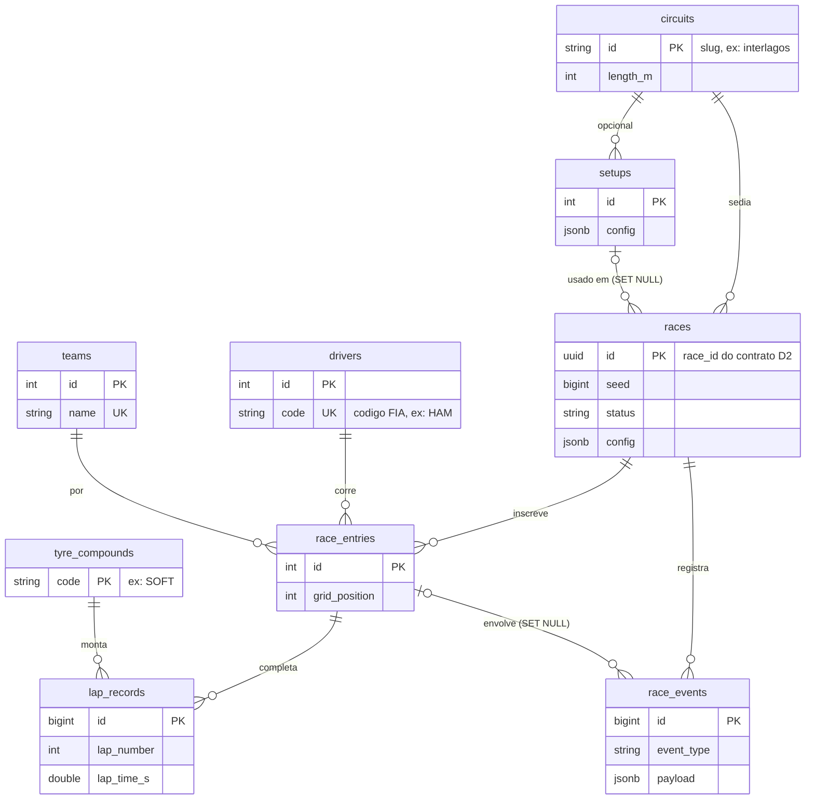

# Banco de dados

PostgreSQL 16 · SQLAlchemy 2 · Alembic. Modelos em `backend/db/models.py`,
migrations em `backend/migrations/`.

O estado *vivo* da corrida mora na memória do motor. O banco recebe só o
histórico, em lote, uma vez por volta (nunca a cada tick), e serve as consultas
dos gráficos pós-corrida.

## Diagrama



## Tabelas

| Tabela | Tipo | O que guarda |
|---|---|---|
| `circuits` | referência | `id` é o slug do contrato D3/D4 (`interlagos`); `length_m` é o comprimento oficial, o mesmo dos JSONs de `circuits/` |
| `drivers` | referência | `code` é o código FIA que o motor emite como `driver_id` |
| `teams` | referência | nome da equipe |
| `tyre_compounds` | referência | `SOFT`, `MEDIUM`, `HARD`, `INTERMEDIATE`, `WET` (os nomes de `TyreCompound` em `sim/state.py`) |
| `setups` | transacional | setup/estratégia salva pelo usuário (CRUD por REST) |
| `races` | transacional | uma corrida: circuito, `seed`, nº de voltas, `status`, snapshot da configuração |
| `race_entries` | transacional | piloto + equipe + posição de largada **naquela** corrida |
| `lap_records` | transacional | uma linha por piloto por volta (espelha `LapResult`) |
| `race_events` | transacional | acidentes, Safety Car/VSC, bandeiras, clima, penalidades |

## Decisões (e o porquê)

**`lap_records` aponta para `race_entries`, não para piloto + corrida.** Assim
o banco impede gravar volta de quem não largou naquela prova, e a equipe de cada
piloto é a da prova (pilotos trocam de equipe entre temporadas). Para persistir,
o motor mapeia `driver_id` (código FIA) → `entry_id` uma vez por corrida.

**Configuração da corrida e do setup em JSONB.** O contrato de API de criação de
corrida (D2) ainda não está no repositório; normalizar agora exigiria uma
migration a cada ajuste dele. As tabelas de que os gráficos dependem
(`lap_records`, `race_events`) são totalmente relacionais. Abandono de piloto
(`is_retired` do D2) e outros marcos entram como `race_events` com `entry_id`. Quando o D2 congelar,
o que for consultado com frequência vira coluna.

**`races.id` é UUID.** É o `race_id` do contrato D2 (REST e WebSocket) e a chave
do motor em memória, então a API gera o id antes de gravar qualquer coisa e o
mesmo valor vale do `POST /api/races` até o `GET .../results`. As demais tabelas
usam inteiro; só o que sai pela API pública precisa de id opaco.

**`drivers.id` substituto, `code` único.** Nas fontes históricas o código se
repete (Michael e Mick Schumacher são `MSC`) e o nome diverge entre datasets; a
reconciliação da semana 4 precisa poder corrigir isso sem reescrever chaves
estrangeiras. Hoje só o grid atual entra no seed.

**`status` da corrida e regras das voltas em `CHECK`, `event_type` livre.**
`ENUM` nativo do PostgreSQL é ruim de reverter em migration. Já `event_type` não
tem `CHECK` porque o gerador de eventos (M3) ainda está sendo desenhado; a
validação fica na camada de repositório e os detalhes de cada tipo, em `payload`.

**As constraints falham alto.** `pit_time_s` só existe com `pit_stop`, tempo de
volta > 0, volta única por piloto, composto tem que existir. O motor grava em
lote: um erro de dado deve estourar na hora, não virar linha silenciosamente
errada. Todas estão cobertas em `backend/tests/db/test_modelos.py`.

**Constraints com nome fixo** (`ck_lap_records_lap_time_positive`, ...) por uma
convenção de nomes no `MetaData`: sem isso o PostgreSQL inventa nomes que variam
entre máquinas e o Alembic não consegue dropar/alterar de forma reprodutível.

## Seed (`make seed`)

Popula as tabelas de referência a partir de `data/mapeamentos/` (gerado por
`make dados`) e da lista de circuitos do projeto. O `make up` já roda o seed
sozinho depois das migrations.

| Tabela | O que entra | Fonte |
|---|---|---|
| `tyre_compounds` | SOFT, MEDIUM, HARD, INTERMEDIATE, WET (os "desconhecidos" ficam de fora) | `compostos.csv` |
| `circuits` | só os 3 do projeto, com o comprimento oficial | `circuitos.csv` + `app/config.py` |
| `drivers` | os 24 pilotos que correram em 2024 (com os substitutos) | `pilotos.csv` |
| `teams` | as 10 equipes de 2024, com o nome do FastF1 | `equipes.csv` |

- **Idempotente**: rodar de novo não duplica, não gasta ids da sequência e corrige
  o que mudou nos CSVs. **Nunca apaga**: uma linha que saiu do CSV continua no banco.
- **Uma temporada só** (`TEMPORADA_DO_SEED`), porque `drivers.code` é UNIQUE e o
  código FIA se repete no histórico (VER também foi o Vergne). São 24 pilotos, e o
  grid de 20 de cada corrida é escolhido na tela de Setup.
- Os nomes de equipe mudam entre temporadas (Alfa Romeo virou Kick Sauber,
  AlphaTauri virou RB). Isso só vira problema ao carregar mais de uma temporada.

## Repositório (`db/repositorio.py`)

Traduz o que o motor e a API falam (código FIA, slug, nome da equipe) para as
chaves do banco. **Não dá commit**: a transação é de quem chama, então um erro no
meio desfaz tudo.

| Função | Para quê |
|---|---|
| `criar_corrida(...)` | Cria a corrida e as inscrições do grid. O grid pode vir só com códigos: a equipe vem de `drivers.team_id`, e uma equipe informada vence. Falha **antes de gravar** (`ReferenciaDesconhecida`) se circuito, piloto ou equipe não existirem, ou se o piloto não tiver equipe padrão. |
| `mapa_entradas(race_id)` | Código FIA -> `race_entries.id`. O motor monta uma vez por corrida. |
| `carregar_corrida(race_id)` | Circuito, seed, config, status e o grid ordenado por largada (código, nome, equipe, `entry_id`). É o que o motor consome: a API só grava e o WebSocket carrega por aqui. |
| `gravar_voltas(mapa, voltas)` | As voltas de um fechamento de volta num único `INSERT`. Piloto fora do mapa derruba o lote antes de enviar. |
| `gravar_eventos(...)`, `registrar_abandono(...)` | Linhas de `race_events`. Evento global fica sem `entry_id`. |
| `atualizar_status(race_id, status)` | Valida contra `STATUS_DA_CORRIDA` e grava `finished_at` ao terminar ou abortar. |

## Persistência em lote (`app/persistencia.py`)

O estado vivo fica em memória, e o banco recebe o histórico **uma vez por volta**,
nunca a cada tick. O motor é assíncrono e o driver (psycopg) é síncrono, então
`GravadorDeCorrida.registrar_volta` leva cada gravação para uma thread
(`asyncio.to_thread`) e abre **uma transação por volta**: se algo falhar, a volta
inteira é desfeita. O `sim/` continua puro; quem monta a corrida entrega o callback ao motor.

```python
gravador = GravadorDeCorrida(engine, race_id)
await gravador.mudar_status("running")
await gravador.registrar_volta(voltas, eventos)  # a cada volta concluída
await gravador.mudar_status("finished")
```

**Custo medido** (`make medir`: 70 voltas x 20 pilotos = 1.400 linhas, PostgreSQL local
no Docker): média de **3,7 ms por volta** (p95 5,9 ms, máximo 11,5 ms, 0,26 s a corrida
inteira). Isso é 0,19% do intervalo entre voltas em 1x (2 s) e menos de 2% em 10x
(0,2 s). A primeira volta é a mais lenta porque monta o mapa de entradas.
É medida em uma máquina, e não é teste do CI, porque teste de tempo é instável.

### Do contrato (`docs/openapi.json`) para o banco

| Contrato D2 | Banco |
|---|---|
| `race_id` (UUID) | `races.id` |
| `CreateRaceRequest.weather`, `track_temp`, `initial_tyres` | `races.config` (JSONB) |
| `CreateRaceRequest.grid` (só códigos) | `race_entries`, com a equipe de `drivers.team_id` |
| `LapResult` do motor | `lap_records`: `lap_time` -> `lap_time_s`, `fuel_load` -> `fuel_load_kg`, `pit_time` -> `pit_time_s`, o composto pelo nome do enum |
| `is_retired` | evento `race_events.event_type = "RETIREMENT"` com `entry_id` (`EVENTO_ABANDONO`) |
| `TyreCompound` (inclui `UNKNOWN`) | `tyre_compounds`, com o `UNKNOWN` carregado pelo seed |

## API de corridas (`app/api/races.py`)

Implementa as três rotas de corrida do contrato D2 (`docs/openapi.json`). Um teste
(`tests/api/test_contrato.py`) lê o próprio `openapi.json` e confere cada resposta e os
campos de cada modelo, nos dois sentidos.

| Rota | O que faz |
|---|---|
| `POST /api/races` (201) | Grava a corrida configurada e devolve `race_id` e `ws_url`. **Não instancia o motor**: o WebSocket carrega a corrida pelo `race_id` (`carregar_corrida`). |
| `GET /api/races/{id}` | Status, `created_at` e `current_lap` (a maior volta gravada; 0 antes da largada). |
| `GET /api/races/{id}/results` | Classificação calculada do histórico gravado. |

Erros: circuito sem registro ou sem mapa de pista é **404**; grid ausente, repetido, com
mais de 20 pilotos ou com piloto desconhecido é **422** (listando os códigos); `race_id`
que não é UUID é 422, e corrida inexistente é 404.

**Decisões**
- **O `grid` é obrigatório na prática.** O contrato o lista como opcional, mas sem grid
  não há corrida, e inventar um padrão seria chutar. O frontend já sempre envia.
- **O circuito é conferido no banco antes do `TrackMap.load`**, que aceita caminhos de
  arquivo; o `circuit_id` também só aceita `[a-z0-9_]`. Assim um id malicioso não lê arquivos.
- **Classificação:** mais voltas completadas primeiro e, no empate, menor tempo total.
  Quem abandonou fica atrás de quem completou mais voltas, mesmo com tempo total menor.
- **`gap_to_leader`** é a diferença para o líder *no mesmo número de voltas*, para continuar
  um número (o contrato não o declara nulo). Quem foi ultrapassado em voltas ou abandonou
  fica com a diferença na última volta que completou, que não é o "+1 volta" da TV.
- **Os pneus iniciais e o clima** ficam em `races.config` (JSONB), porque o motor os lê dali.

## Próximos passos

- **Motor e WebSocket (Gabriel):** `carregar_corrida` na montagem e `registrar_volta` a cada volta.
- **Quando houver mais de uma temporada:** reconciliar os nomes de equipe entre elas.
