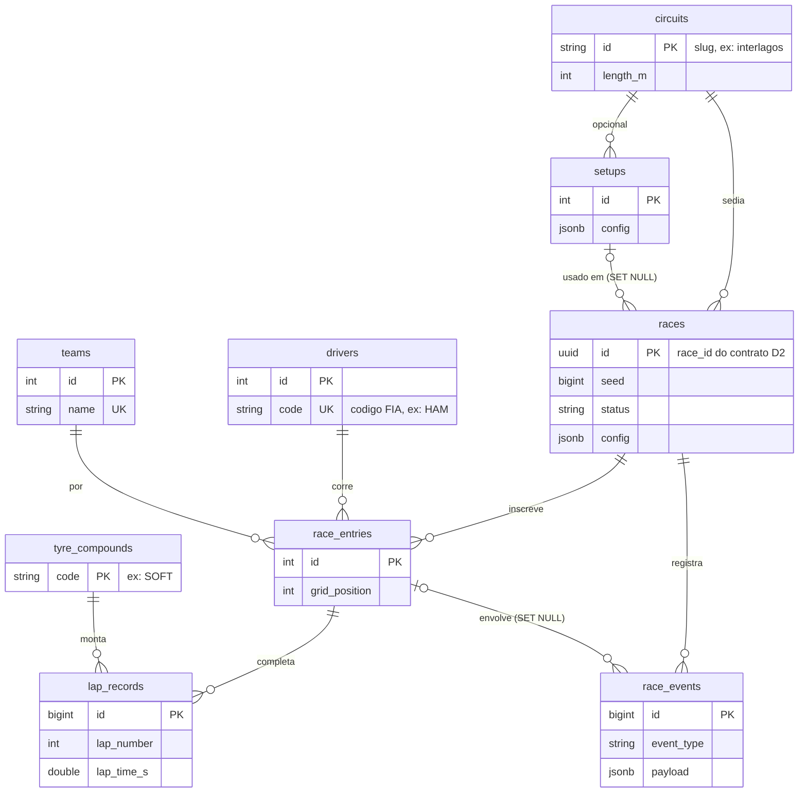

# Banco de dados

PostgreSQL 16 · SQLAlchemy 2 · Alembic. Modelos em `backend/db/models.py`,
migrations em `backend/migrations/`.

O estado *vivo* da corrida mora na memória do motor. O banco recebe só o
histórico, em lote, uma vez por volta (nunca a cada tick), e serve as consultas
dos gráficos pós-corrida.

## Diagrama

## Tabelas

| Tabela | Tipo | O que guarda |
|---|---|---|
| `circuits` | referência | `id` é o slug do contrato D3/D4 (`interlagos`); `length_m` é o comprimento oficial, o mesmo dos JSONs de `circuits/` |
| `drivers` | referência | `code` é o código FIA que o motor emite como `driver_id` |
| `teams` | referência | nome da equipe |
| `tyre_compounds` | referência | `SOFT`, `MEDIUM`, `HARD`, `INTERMEDIATE`, `WET` (os nomes de `TyreCompound` em `sim/state.py`) |
| `setups` | transacional | setup/estratégia salva pelo usuário (CRUD por REST) |
| `races` | transacional | uma corrida: circuito, `seed`, nº de voltas, `status`, snapshot da configuração |
| `race_entries` | transacional | piloto + equipe + posição de largada **naquela** corrida |
| `lap_records` | transacional | uma linha por piloto por volta (espelha `LapResult`) |
| `race_events` | transacional | acidentes, Safety Car/VSC, bandeiras, clima, penalidades |

## Decisões (e o porquê)

**`lap_records` aponta para `race_entries`, não para piloto + corrida.** Assim
o banco impede gravar volta de quem não largou naquela prova, e a equipe de cada
piloto é a da prova (pilotos trocam de equipe entre temporadas). Para persistir,
o motor mapeia `driver_id` (código FIA) → `entry_id` uma vez por corrida.

**Configuração da corrida e do setup em JSONB.** O contrato de API de criação de
corrida (D2) ainda não está no repositório; normalizar agora exigiria uma
migration a cada ajuste dele. As tabelas de que os gráficos dependem
(`lap_records`, `race_events`) são totalmente relacionais. Abandono de piloto
(`is_retired` do D2) e outros marcos entram como `race_events` com `entry_id`. Quando o D2 congelar,
o que for consultado com frequência vira coluna.

**`races.id` é UUID.** É o `race_id` do contrato D2 (REST e WebSocket) e a chave
do motor em memória, então a API gera o id antes de gravar qualquer coisa e o
mesmo valor vale do `POST /api/races` até o `GET .../results`. As demais tabelas
usam inteiro; só o que sai pela API pública precisa de id opaco.

**`drivers.id` substituto, `code` único.** Nas fontes históricas o código se
repete (Michael e Mick Schumacher são `MSC`) e o nome diverge entre datasets; a
reconciliação da semana 4 precisa poder corrigir isso sem reescrever chaves
estrangeiras. Hoje só o grid atual entra no seed.

**`status` da corrida e regras das voltas em `CHECK`, `event_type` livre.**
`ENUM` nativo do PostgreSQL é ruim de reverter em migration. Já `event_type` não
tem `CHECK` porque o gerador de eventos (M3) ainda está sendo desenhado; a
validação fica na camada de repositório e os detalhes de cada tipo, em `payload`.

**As constraints falham alto.** `pit_time_s` só existe com `pit_stop`, tempo de
volta > 0, volta única por piloto, composto tem que existir. O motor grava em
lote: um erro de dado deve estourar na hora, não virar linha silenciosamente
errada. Todas estão cobertas em `backend/tests/db/test_modelos.py`.

**Constraints com nome fixo** (`ck_lap_records_lap_time_positive`, ...) por uma
convenção de nomes no `MetaData`: sem isso o PostgreSQL inventa nomes que variam
entre máquinas e o Alembic não consegue dropar/alterar de forma reprodutível.

## Próximos passos (já previstos)

- **Semana 4:** tabelas de alias para reconciliar nomes de pilotos, códigos de
  circuito e compostos entre as fontes, e a tabela das curvas de degradação (D5).
- **Semana 5:** seed idempotente e camada de repositório com testes de integração.
