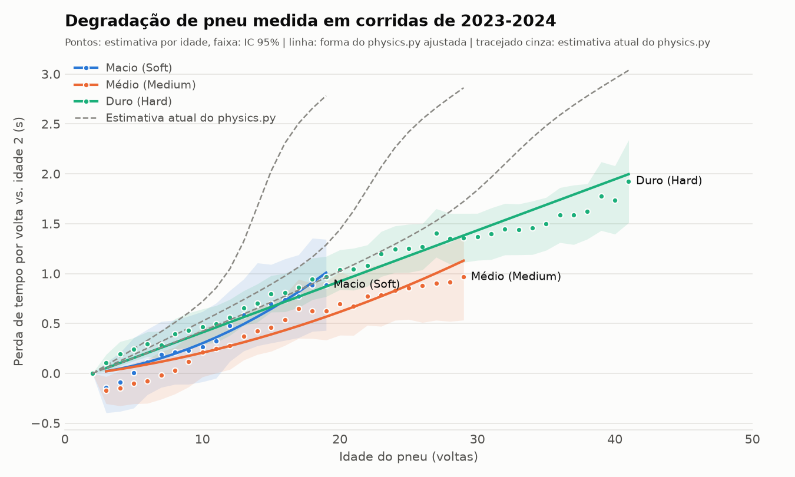

# Datasets do Kaggle: reconciliação e curvas de degradação (D5)

Entrega da semana 4 do M1, consumida pelo Isaac (física). Gerar tudo do zero:

```bash
# no .env: KAGGLE_API_TOKEN=KGAT_...   (kaggle.com > Settings > API > Create Token)
make dados        # baixa (se preciso), reconcilia e ajusta as curvas, ~20 s
```

| Saída | Versionada? | O que é |
|---|---|---|
| `data/raw/` | não | os 3 datasets brutos (174 MB) |
| `data/mapeamentos/*.csv` | sim | tabelas de correspondência entre as fontes |
| `data/curvas_degradacao/curvas_degradacao.json` | sim | **a entrega ao Isaac** |
| `data/curvas_degradacao/curvas_degradacao.png` | sim | gráfico de conferência |
| `data/curvas_degradacao/sensibilidade.csv` | sim | quanto a curva muda com os filtros |

## O que cada dataset alimenta de fato

| Dataset | Conteúdo | Uso no ApexSim |
|---|---|---|
| `jtrotman/formula-1-race-data` | histórico do Ergast desde 1950: pilotos, circuitos, corridas, resultados | **referência de identidade**: dá o id estável de cada piloto e circuito. Vai alimentar o seed do banco (semana 5) |
| `vanshbatra26/f1-tyre-strategy-engine-datasets` | 80 mil voltas de 2023 e 2024 (FastF1), com composto, idade do pneu e clima, de todas as sessões | **fonte das curvas de degradação** |
| `alexjr2001/formula-1-dataset-race-data-and-telemetry` | 23.674 voltas de 21 corridas de 2024 | **validação cruzada**: 98,5% das voltas dele estão no dataset de pneus com o mesmo tempo, ao milissegundo. Ele não traz informação nova para a degradação, então não entra no ajuste (entraria em dobro) |

## Reconciliação (`data/mapeamentos/`)

As três fontes chamam as mesmas coisas de jeitos diferentes. Cada tabela diz, para
cada nome visto numa fonte, a qual entidade ele corresponde. A regra é **falhar
alto**: um GP, piloto ou composto sem regra derruba o `make dados`, em vez de
virar dado silenciosamente errado.

- **Circuitos** (`circuitos.csv`, 24 GPs): o nome do GP (`São Paulo Grand Prix`)
  vira o slug usado no resto do projeto (`interlagos`). O `alexjr2001` escreve com
  `_` no nome do arquivo. Os 3 circuitos do ApexSim estão cobertos nas duas
  temporadas.
- **Pilotos** (`pilotos.csv`, 46 pares temporada + código): a chave é
  **(temporada, código)**, não só o código, porque o código FIA se repete no
  histórico: 7 códigos são repetidos (`VER`, `ALB`, `MAG`, `DOO`, `MSC`, `BIA`,
  `HAR`). Quatro deles afetam pilotos de 2023-2024, em 7 pares (temporada,
  piloto): `VER` é também o Vergne, `ALB` o Albers, `MAG` o Jan Magnussen e `DOO`
  o Doornbos. Dentro de uma temporada o código é único, e isso é verificado. Os 23 códigos que só aparecem em treino livre (pilotos reserva)
  ficam fora.
- **Equipes** (`equipes.csv`): as equipes de cada temporada com os pilotos que
  correram por elas, usando o nome do FastF1. O Bearman aparece em duas em 2024
  (Ferrari e Haas). Os nomes mudam entre temporadas e a tabela não os liga.
- **Compostos** (`compostos.csv`): os cinco compostos oficiais viram o código da
  tabela `tyre_compounds`. `UNKNOWN` e `TEST_UNKNOWN` (289 voltas, compostos que o
  FastF1 não identifica) são descartados. `chave_fisica` é o nome em minúsculas usado no
  `physics.py`.
- **Sobreposição** (`sobreposicao_fontes.csv`): duas divergências achadas e
  registradas:
  - **Mônaco 2024**: as fontes numeram as voltas com 1 de diferença (a corrida
    teve bandeira vermelha na volta 1). Com o deslocamento, 98% das voltas batem.
  - **Bélgica 2024**: 14% das voltas discordam no composto entre as fontes. O
    ajuste é refeito sem esses dois GPs na análise de sensibilidade.

## Curvas de degradação (`curvas_degradacao.json`)

### Como foram medidas

Comparar tempo de volta cru entre idades de pneu engana: o carro fica mais leve a
cada volta, a pista melhora, e pilotos e circuitos têm ritmos diferentes. O tempo
de cada volta é modelado como

```
tempo = base(piloto, corrida) + inclinação(corrida) × volta
        + deslocamento(composto) + degradação(composto, idade)
```

e a degradação é estimada **idade a idade, sem impor forma**, relativa à idade 2
(a primeira volta limpa de um stint). Só depois se ajusta a forma do `physics.py`
(`k1·a² + k2·a + cliff`). A `inclinação × volta` absorve combustível e evolução da
pista juntos, sem precisar assumir um valor para nenhum dos dois.

**Filtros** (em `app/config.py`): só corrida, pista seca, SOFT, MEDIUM e HARD;
fora a volta 1, as voltas de saída e entrada do box e as voltas acima de 107% da
mediana do piloto na corrida (Safety Car, VSC). Uma idade só entra com pelo menos
100 voltas. Sobram **39.966 voltas de 44 corridas**. O erro-padrão é agrupado por
corrida, porque voltas da mesma prova compartilham pista, clima e Safety Car.

### Resultado

| Composto | Medido até | Perda na idade 10 | Perda na idade 15 | `k1_quad` | `k2_lin` | Cliff |
|---|---|---|---|---|---|---|
| SOFT | 19 voltas | 0,27 s | 0,70 s | 0,00241 | 0,0086 | não observado |
| MEDIUM | 29 voltas | 0,21 s | 0,46 s | 0,00085 | 0,0156 | não observado |
| HARD | 41 voltas | 0,47 s | 0,80 s | 0 (curva côncava) | 0,0512 | não observado |



**Para o Isaac:**

1. **A estimativa atual do `physics.py` superestima a degradação do SOFT e do
   MEDIUM em 2 a 3 vezes** (idade 15: SOFT 2,03 s estimado contra 0,70 s medido;
   MEDIUM 0,89 contra 0,46). Para o **HARD ela bate** até cerca de 15 voltas
   (0,71 contra 0,80) e passa a superestimar depois, por causa do cliff (41
   voltas: 3,04 contra 1,92). Tracejado cinza no gráfico. Os dados sustentam
   trocar `k1_quad` e `k2_lin` pelos valores medidos.
2. **Nenhum cliff aparece na faixa medida.** O `cliff: null` no JSON quer dizer
   "não observado", não "não existe": as equipes trocam o pneu antes de ele
   chegar lá, então os dados não alcançam o cliff. Os `cliff_*` do `physics.py`
   continuam sendo estimativa e devem ser rotulados assim. Um cliff só é aceito
   se melhorar o BIC em pelo menos 10 e estiver a pelo menos 2 voltas das pontas
   dos dados. O HARD chegou a passar no BIC, mas com o cliff colado na volta 3,
   o que é uma curva côncava disfarçada, e foi recusado.
3. **Para o HARD, a forma quadrática não serve bem**: a curva medida é côncava
   (perde rápido no começo e estabiliza), e `k1 ≥ 0` encosta em zero
   (`k1_no_limite_inferior: true`). A `curva` idade a idade no JSON é mais fiel
   que os parâmetros. Vale interpolar direto nela.
4. **Não use `idade_max_suportada` como vida útil.** É só até onde há 100 voltas.

### Sensibilidade (`sensibilidade.csv`)

Mudar o limite de volta anômala de 107% para 105% ou 110% muda a perda na idade
15 em até 0,05 s. Tirar Mônaco e Bélgica muda até 0,12 s (no SOFT, que tem menos
voltas). As conclusões acima não mudam em nenhuma variante.

### Limitações (para a arguição)

- **Viés de seleção**: só chega a idades altas o stint que estava indo bem. As
  idades altas tendem a subestimar a degradação.
- **Mistura de circuitos**: o HARD é mais usado em pistas de alta degradação, e
  a curva é uma média sobre as pistas em que cada composto foi usado. Isso
  provavelmente explica o HARD aparecer degradando mais que o MEDIUM. **Próximo
  passo**: estimar por circuito para Interlagos, Monza e Mônaco quando houver
  voltas suficientes.
- **Temperatura da pista** não entra aqui. O `physics.py` a trata num termo
  separado (`TRACK_TEMP_PENALTY_PER_C`).
- Tráfego e gestão de pneu pelo piloto não são controlados.
