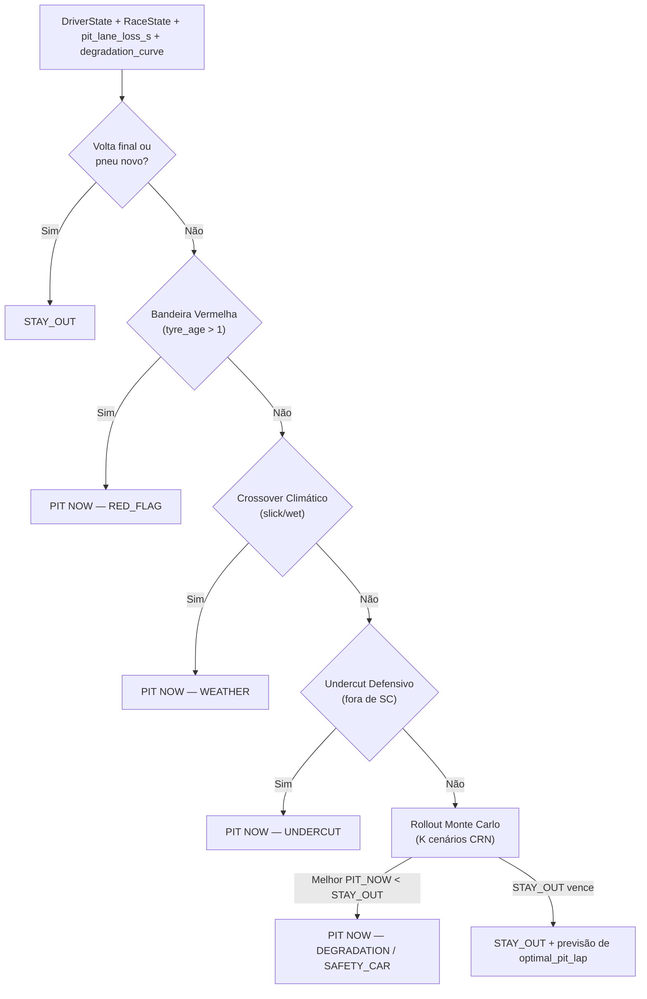

# ApexSim — Estratégia de Pit Stop e Otimização por Monte Carlo (`docs/estrategia.md`)

> Documento técnico do módulo de estratégia e IA do **ApexSim** (`backend/strategy/`). Descreve a arquitetura em dois degraus — Heurística Reativa (Marco M3) e Otimização Estocástica por Monte Carlo (Marco M4) —, seus contratos de dados, formulação matemática, redução de variância, convergência e integração com o motor de simulação (`RaceEngine`).

---

## 1. Arquitetura em Dois Degraus

O módulo `backend/strategy/` segue os mesmos princípios arquiteturais de `sim/` definidos em [arquitetura.md](arquitetura.md): **funções puras determinísticas em memória**, zero dependência de FastAPI, WebSockets ou PostgreSQL, e semente pseudoaleatória encapsulada em instância própria (`random.Random(seed)`).

A tomada de decisão é organizada em dois degraus que compartilham exatamente o mesmo contrato de chamada (`evaluate_driver(...) -> PitDecision`):

1. **Degrau 1 — Heurística de Custo-Benefício com Camadas Reativas (`backend/strategy/heuristic.py`, M3):**
   Avalia em cascata de prioridades determinísticas: Bandeira Vermelha, Crossover Climático, Safety Car / VSC, Undercut Defensivo e o algoritmo base de degradação acumulada sobre horizonte fixo $H$.
2. **Degrau 2 — Otimização Estocástica por Monte Carlo (`backend/strategy/monte_carlo.py`, M4):**
   Herda de `PitStrategyHeuristic`, preserva as camadas reativas imediatas e substitui a comparação determinística de degradação por uma simulação de $K$ cenários futuros sob incerteza de desgaste de pneus, variação no tempo de box e ocorrência estocástica de Safety Car/VSC, avaliando múltiplos compostos e momentos de parada.



---

## 2. Contratos de Dados

### 2.1 `PitDecision` (Degraus 1 e 2)

Contrato padrão consumido pelo `RaceEngine` em cada volta:

| Campo | Tipo | Descrição |
|---|---|---|
| `should_pit` | `bool` | `True` se o piloto deve entrar nos boxes na próxima volta. |
| `target_compound` | `str \| None` | Composto sugerido (`"soft"`, `"medium"`, `"hard"`, `"wet"`) ou `None` em `STAY_OUT`. |
| `reason` | `str` | Motivo: `"DEGRADATION"`, `"SAFETY_CAR"`, `"RED_FLAG"`, `"WEATHER"`, `"UNDERCUT"` ou `"STAY_OUT"`. |

### 2.2 `StrategyCandidate` (Degrau 2)

Representa cada ação estratégica avaliada nos $K$ cenários futuros:

| Campo | Tipo | Descrição |
|---|---|---|
| `pit_offset` | `int \| None` | `0` para parar nesta volta, $> 0$ para parar daqui a `pit_offset` voltas, `None` para `STAY_OUT`. |
| `target_compound` | `str \| None` | Composto avaliado (`"soft"`, `"medium"`, `"hard"`, `"wet"`) ou `None`. |
| `expected_cost_s` | `float` | Perda de tempo média (s) nos $K$ cenários simulados. |
| `std_cost_s` | `float` | Desvio-padrão populacional (s) da perda de tempo nos $K$ cenários. |
| `score_s` | `float` | Pontuação final ponderada por aversão a risco (menor é melhor). |

### 2.3 `MonteCarloPlan` (Degrau 2)

Retornado por `MonteCarloStrategyOptimizer.optimize_driver(...)`:

| Campo | Tipo | Descrição |
|---|---|---|
| `decision` | `PitDecision` | Decisão imediata compatível com o contrato D1. |
| `optimal_pit_lap` | `int \| None` | Volta ótima estimada (`current_lap` se `should_pit=True`, `current_lap + best_offset` se prevista no horizonte, ou `None`). |
| `best_compound` | `str \| None` | Composto ótimo identificado para o próximo stint. |
| `candidates` | `tuple[StrategyCandidate, ...]` | Candidatos ordenados por `score_s` crescente. |
| `num_scenarios` | `int` | Número $K$ de cenários simulados (`0` quando resolvido por camada reativa rápida). |

---

## 3. Degrau 1 — Formulação da Heurística Reativa

### 3.1 Algoritmo Base de Degradação

Dado o composto atual $c$, a idade do pneu $a$, as voltas restantes $L_{\text{rem}} = \max(1, N - l)$ e o horizonte de projeção $H = \min(L_{\text{rem}}, H_{\text{default}})$ com $H_{\text{default}} = 15$:

\[
\Delta t_{\text{deg}}(c, c_{\text{alvo}}, a, H) = \sum_{j=1}^{H} t_{\text{tire}}(c, a + j) - \sum_{j=1}^{H} t_{\text{tire}}(c_{\text{alvo}}, j)
\]

O custo ajustado da parada é modulado pela agressividade da equipe $\alpha \in [0, 1]$ (`DEFAULT_AGGRESSION = 0.5`):

\[
f_{\text{agg}}(\alpha) = 1{,}25 - 0{,}50 \cdot \alpha
\]

\[
C_{\text{pit,ajust}}(\alpha) = \left(L_{\text{pit}} + t_{\text{troca}} + t_{\text{warmup}}\right) \cdot f_{\text{agg}}(\alpha)
\]

onde $L_{\text{pit}}$ é o tempo perdido no pit lane do circuito (`time_loss_s` do `TrackMap`, ex.: $21{,}0\text{ s}$ em Interlagos), $t_{\text{troca}} = 2{,}5\text{ s}$ (`DEFAULT_PIT_STOP_DURATION`) e $t_{\text{warmup}} = 1{,}0\text{ s}$ (`DEFAULT_WARMUP_PENALTY`). A parada por degradação é acionada quando:

\[
\Delta t_{\text{deg}}(c, c_{\text{alvo}}, a, H) > C_{\text{pit,ajust}}(\alpha)
\]

Equipes agressivas ($\alpha = 0{,}9 \Rightarrow f_{\text{agg}} = 0{,}80$) antecipam o undercut; equipes conservadoras ($\alpha = 0{,}1 \Rightarrow f_{\text{agg}} = 1{,}20$) estendem o stint.

### 3.2 Camadas Reativas e Regra FIA de Compostos

1. **Bandeira Vermelha (`RED`):** se $a > 1$, troca gratuita imediata (`reason="RED_FLAG"`).
2. **Crossover Climático:** normaliza estados em português e inglês (`seco`/`DRY`, `umido`/`DAMP`, `molhado`/`WET`) e realiza a troca imediata quando o composto é incompatível com a condição da pista (slick em pista úmida $\to$ `"intermediate"`, slick ou intermediário com $> 5$ voltas restantes em pista molhada $\to$ `"wet"`, pneu de chuva em pista seca $\to$ slick ideal).
3. **Safety Car / VSC:** reduz a perda relativa no pit lane pelo fator `SAFETY_CAR_COST_FACTOR = 0.55` e antecipa a parada se o prejuízo superar o custo reduzido ou se $a \ge \lfloor 14 - 6\alpha \rfloor$. Bandeira amarela local (`YELLOW`) **não** aciona esse desconto.
4. **Undercut Defensivo:** se o carro imediatamente atrás ($\le 2{,}5\text{ s}$) parou na volta anterior, $a \ge 10$ e $L_{\text{rem}} > 5$, responde na volta seguinte (`reason="UNDERCUT"`).
5. **Seleção de Composto:** no seco, prefere `"soft"` para $L_{\text{rem}} \le 15$, `"medium"` para $15 < L_{\text{rem}} \le 30$ e `"hard"` para $L_{\text{rem}} > 30$, impondo a regra esportiva FIA de **não repetir consecutivamente o mesmo composto** em pista seca.

---

## 4. Degrau 2 — Otimização por Monte Carlo (`MonteCarloStrategyOptimizer`)

### 4.1 Modelo Generativo dos $K$ Cenários

A cada chamada de `optimize_driver` em condições avaliáveis ($a \ge a_{\min} = 5$ em bandeira verde, ou sob `SAFETY_CAR`/`VSC`), o otimizador gera $K$ cenários futuros independentes usando a instância local `self.rng = random.Random(seed)`. Para cada cenário $k \in \{1, \dots, K\}$:

1. **Incerteza na taxa de desgaste ($\eta_k$):**
   \[
   \eta_k = \max\!\left(0{,}4,\; 1 + \varepsilon_{\text{deg},k}\right), \quad \varepsilon_{\text{deg},k} \sim \mathcal{N}(0, \sigma_{\text{deg}}^2)
   \]
   com $\sigma_{\text{deg}} = 0{,}10$ (`MC_DEG_NOISE_STD`), alinhado ao `erro_padrao_s` empírico de `data/curvas_degradacao/curvas_degradacao.json`.
2. **Incerteza na execução do pit stop ($\delta_{\text{pit},k}$):**
   \[
   \delta_{\text{pit},k} = \max\!\left(-1{,}0,\; \varepsilon_{\text{pit},k}\right), \quad \varepsilon_{\text{pit},k} \sim \mathcal{N}(0, \sigma_{\text{pit}}^2)
   \]
   com $\sigma_{\text{pit}} = 0{,}35\text{ s}$ (`MC_PIT_DURATION_STD`).
3. **Ocorrência futura de Safety Car / VSC ($l_{\text{SC},k}$):**
   Sob bandeira verde e $H > 1$, a probabilidade de ocorrer ao menos uma neutralização dentro do horizonte $H$ a partir da taxa por volta $p_{\text{SC}} = 0{,}035$ (`MC_SC_PROB_PER_LAP`, calibrada para $\approx 1{,}0\text{ SC} + 0{,}95\text{ VSC}$ em $58$ voltas segundo [fisica.md](fisica.md)) é:
   \[
   P_{\text{SC}}(H) = 1 - (1 - p_{\text{SC}})^H
   \]
   Quando ocorre em $l_{\text{SC},k} \sim \mathcal{U}\{1, \dots, H\}$, as voltas neutralizadas comprimem o diferencial de ritmo de pneus pelo fator $\gamma_{\text{pace},k} = \frac{H - 0{,}65 \cdot \min(2, H - l_{\text{SC},k} + 1)}{H}$ e concedem desconto de oportunidade caso a estratégia esteja em espera imediata ($l_{\text{SC},k} \le 2$) ou programada para parar após a neutralização ($l_{\text{SC},k} \le d$).
4. **Evolução Climática Dinâmica via Cadeia de Markov (opcional, `dynamic_weather=True`):**
   Quando ativado (no construtor ou via `race_state["dynamic_weather"]`), cada cenário $k$ evolui o estado climático $w_t \in \{\text{seco}, \text{umido}, \text{molhado}\}$ ao longo das $H$ voltas usando a matriz de transição de `sim/weather.py` (`DEFAULT_TRANSITION_PROBABILITIES`) e acumula a penalidade composto $\times$ clima (`WEATHER_COMPOUND_TIME_PENALTIES`). Caso uma virada climática ocorra nas próximas 4 voltas, parar agora no composto antigo incorre no custo de uma segunda parada forçada, permitindo ao otimizador adiar a parada slick diante de chuva iminente.

### 4.2 Redução de Variância via *Common Random Numbers (CRN)*

Todos os candidatos — `STAY_OUT`, `PIT_NOW` para cada composto permitido pela regra FIA (`soft`, `medium`, `hard`) e deslocamentos futuros `pit_offset` $d \in \{2, 4, \dots, \min(H, L_{\text{rem}} - 2)\}$ — são avaliados **sobre os mesmos $K$ cenários** $(\eta_k, \delta_{\text{pit},k}, l_{\text{SC},k})$.

O uso de CRN elimina a variância espúria entre alternativas, estabilizando a ordenação de compostos e janelas com $K = 64$ rollouts (`MC_DEFAULT_SCENARIOS`), além de permitir pré-cálculo determinístico das somas de degradação fora do laço dos $K$ cenários.

### 4.3 Função Objetivo Ponderada por Risco e Penalidade de Stint

Para cada candidato $m$, com média amostral $\mu_m$ e desvio-padrão $\sigma_m$ nos $K$ cenários:

\[
J_m = \mu_m + \lambda_{\text{risco}} \cdot \sigma_m, \quad \lambda_{\text{risco}} = 0{,}20
\]

A penalidade por inadequação de stint (`_compound_stint_mismatch_penalty`) garante que horizontes curtos ($H = 15$) não escolham compostos inviáveis para o restante da prova (por exemplo, montar `soft` faltando 35 voltas quando seu *cliff* térmico ocorre em 25 voltas, ou montar `hard` em sprint de 10 voltas). Para o composto ideal $c_{\text{pref}}$ selecionado pela regra de durabilidade, a penalidade é exatamente $0{,}0$.

A decisão de parar imediatamente (`should_pit = True`) ocorre quando:

\[
\min_{c \in \mathcal{C}_{\text{válidos}}} J_{\text{PIT\_NOW}}(c) < J_{\text{STAY\_OUT}}
\]

### 4.4 Convergência Matemática com a Heurística (Teste de Sanidade)

Quando as fontes de incerteza são anuladas ($\sigma_{\text{deg}} = 0$, $\sigma_{\text{pit}} = 0$, $p_{\text{SC}} = 0$):
- $\eta_k = 1$, $\delta_{\text{pit},k} = 0$, $\gamma_{\text{pace},k} = 1$ e $\sigma_m = 0$ para todo candidato $m$;
- O melhor candidato `PIT_NOW` é $c_{\text{pref}}$ (penalidade de stint $= 0$);
- $J_{\text{PIT\_NOW}}(c_{\text{pref}}) < J_{\text{STAY\_OUT}}$ reduz-se algebricamente a:
  \[
  \sum_{j=1}^{H} t_{\text{tire}}(c_{\text{pref}}, j) + C_{\text{pit,ajust}}(\alpha) < \sum_{j=1}^{H} t_{\text{tire}}(c, a + j)
  \iff \Delta t_{\text{deg}} > C_{\text{pit,ajust}}(\alpha)
  \]
- Sob `SAFETY_CAR` / `VSC`, permanecer na pista quando $a \ge \lfloor 14 - 6\alpha \rfloor$ incorre no custo de oportunidade da parada futura sob bandeira verde, convergindo exatamente para o gatilho do Degrau 1.

---

## 5. Hiperparâmetros (`backend/strategy/config.py`)

| Constante | Valor Padrão | Papel |
|---|---|---|
| `DEFAULT_HORIZON` / `MC_HORIZON_LAPS` | `15` | Horizonte de projeção em voltas. |
| `DEFAULT_PIT_STOP_DURATION` | `2.5` s | Tempo estacionário médio de troca de pneus. |
| `DEFAULT_WARMUP_PENALTY` | `1.0` s | Penalidade térmica na volta de saída dos boxes. |
| `SAFETY_CAR_COST_FACTOR` | `0.55` | Fator de custo do pit lane sob Safety Car / VSC. |
| `UNDERCUT_GAP_THRESHOLD` | `2.5` s | Distância máxima ao carro de trás para reagir a undercut. |
| `UNDERCUT_MIN_AGE` | `10` voltas | Idade mínima do pneu para defesa de undercut. |
| `MC_DEFAULT_SCENARIOS` | `64` | Quantidade padrão $K$ de rollouts estocásticos. |
| `MC_SC_PROB_PER_LAP` | `0.035` | Probabilidade por volta de ocorrer Safety Car / VSC futuro. |
| `MC_DEG_NOISE_STD` | `0.10` | Desvio-padrão relativo do desgaste de pneu por cenário. |
| `MC_PIT_DURATION_STD` | `0.35` s | Desvio-padrão da duração da parada nos boxes. |
| `MC_MIN_TYRE_AGE_FOR_ROLLOUT` | `5` voltas | Filtro rápido para pular rollouts no início de stint sob verde. |

---

## 6. Integração com o Motor e Resultados de Validação

Como `MonteCarloStrategyOptimizer` implementa exatamente `evaluate_driver(driver_state, race_state, pit_lane_loss_s, degradation_curve) -> PitDecision`, sua ativação no `RaceEngine` requer apenas instanciá-lo no lugar de `PitStrategyHeuristic`:

```python
from sim.physics import tyre_time_loss
from strategy import MonteCarloStrategyOptimizer

optimizer = MonteCarloStrategyOptimizer(
    team_aggression=team_aggression,
    num_scenarios=64,
    seed=race_seed,
)

decision = optimizer.evaluate_driver(
    driver_state=driver,
    race_state=race_state,
    pit_lane_loss_s=pit_lane_loss_s,
    degradation_curve=lambda comp, age: tyre_time_loss(comp, age, track_temp=35.0),
)
```

Caso o consumidor também queira inspecionar a volta ótima estimada ou o ranking completo dos candidatos avaliados, basta chamar `optimizer.optimize_driver(...)`, que devolve um `MonteCarloPlan`.

### Resumo dos Testes (`backend/tests/test_monte_carlo.py`)

- **Sanidade / Convergência:** Com incerteza zerada, todas as 10 equipes (agressividade de `0.1` a `0.9`), múltiplos compostos iniciais (`soft`, `medium`, `hard`) e cenários de `SAFETY_CAR` convergem em 100% das voltas e compostos para a `PitStrategyHeuristic`.
- **Determinismo e Incerteza:** Mesma `seed` reproduz planos idênticos; equipes agressivas (`0.9`) param antes das conservadoras (`0.1`) e respeitam a regra FIA de alternância.
- **Desempenho:** Uma simulação completa de 55 voltas para o grid de 20 carros com $K = 64$ cenários executa em menos de **1 segundo** (muito abaixo do limite de 30 segundos definido para a M4), com janelas de parada entre as voltas 25 e 31.
