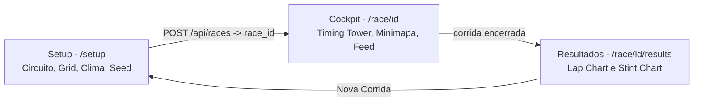

# ApexSim — Frontend UX: Jornada do Usuário e Especificação de Telas

> Referência de produto para Anderson (Frontend). Descreve o fluxo de navegação e os componentes de cada tela.
> Contratos de dados que alimentam as telas estão em [arquitetura.md](arquitetura.md).

---

## 1. Fluxo de Navegação



---

## 2. Tela de Setup (`/setup`)

**Objetivo:** Configurar o cenário antes de iniciar a simulação.

| Componente | Descrição | Endpoint |
|---|---|---|
| Seletor de Circuito | Cards visuais de Interlagos, Monza e Mônaco | `GET /circuits/{id}.json` |
| Grid de Largada | 20 pilotos, drag & drop de posições ou sorteio | — |
| Condições Climáticas | Seco / Úmido / Chuva + temperatura inicial de pista | — |
| Seed | Campo opcional para corrida determinística | — |
| Botão Iniciar | Envia a configuração e redireciona para o cockpit | `POST /api/races` |

---

## 3. Cockpit ao Vivo (`/race/:id`)

**Objetivo:** Visualização imersiva da prova em andamento via WebSocket.

```
+----------------------------------------------------------+
| GP de Interlagos | Volta 18/53 | VERDE | 32C | PAUSE  5x |
+----------------------+-----------------------------------+
| TIMING TOWER         |                                   |
| P  Piloto  Gap  Pneu |   MINIMAPA 2D SVG (M4)            |
|  1 VER  LIDER  M(18) |   carros interpolados no tracado  |
|  2 NOR +1.4s   M(18) |                                   |
|  3 LEC +3.1s   H(18) +-----------------------------------+
| ... animacao suave   | FEED DA DIRECAO DE PROVA           |
|    na troca de pos.  | Volta 18: Safety Car acionado      |
+----------------------+-----------------------------------+
```

### 3.1 Top Bar
- Volta atual / total de voltas.
- Badge colorido de status da pista: `GREEN` (verde), `VSC` (amarelo), `SAFETY_CAR` (amarelo piscante), `RED` (vermelho).
- Controles: Play/Pause, seletor de velocidade (`1x`, `2x`, `5x`, `10x`).

### 3.2 Timing Tower (coluna esquerda)
- 20 pilotos em ordem de posição.
- Colunas: posição, código do piloto (barra de cor da equipe), gap para o líder, gap para o carro à frente, último tempo de volta, composto de pneu com cores oficiais (`S`=vermelho, `M`=amarelo, `H`=branco), idade do pneu em voltas.
- Badge de DRS ativo.
- **Animação obrigatória:** trocas de posição com transição CSS suave — sem pulo seco.

### 3.3 Minimapa 2D — M4 (centro-superior)
- Traçado SVG gerado a partir dos pontos de `circuits/{id}.json`.
- 20 marcadores na cor da equipe, interpolados suavemente usando o campo `distance_m` do `lap_update`.
- Zonas de DRS destacadas no traçado.

### 3.4 Feed da Direção de Prova (centro-inferior)
- Log cronológico de mensagens `event_update`: acidentes, Safety Car/VSC, pit stops, ativação de DRS.

---

## 4. Resultados e Analytics (`/race/:id/results`)

**Objetivo:** Análise do resultado e comportamento estratégico da corrida encerrada.

| Componente | Descrição | Endpoint |
|---|---|---|
| Classificação Final | Tabela com tempo total, pit stops e volta mais rápida | `GET /api/races/{id}/results` |
| Lap Chart | Linhas de posição por volta (X = volta, Y = posição invertida P1-P20). Clique em piloto para destacar. | idem |
| Stint Chart | Barras horizontais com blocos coloridos por composto e volta das paradas | idem |
| Log de Incidentes | Resumo de Safety Cars e abandonos | idem |
| Botão Nova Corrida | Redireciona para `/setup` | — |
